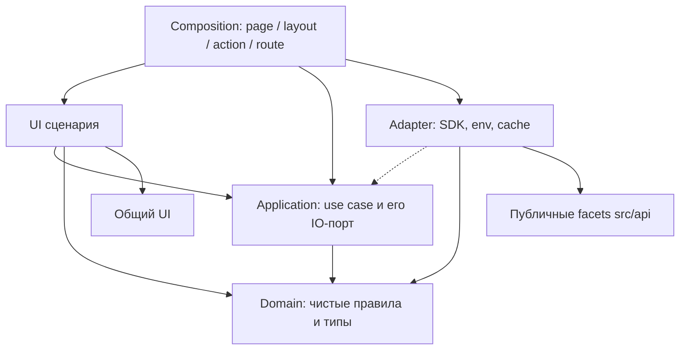

# Архитектура: vertical slice и clean architecture

> Тип: объяснение · Статус: актуально · Источники истины: дерево репозитория,
> [`tsconfig.json`](../../tsconfig.json), [`next.config.ts`](../../next.config.ts) и
> [`AGENTS.md`](../../AGENTS.md). Принятые решения закреплены в
> [`ARCHITECTURE.md`](../../ARCHITECTURE.md).

При добавлении кода, переносе компонентов и изменении межслойных импортов проверяйте
по этому документу размещение файлов и границу клиентского кода.

## Главное

Проект использует ESM и Next.js с одним `package.json`. API находится в `src/api/`,
UI-примитивы находятся в `src/components/ui/`.

Проект принимает vertical slice для группировки функциональности и clean architecture
для направления зависимостей. Срез объединяет один пользовательский сценарий: его UI,
входные данные, правила и адаптер API. Тесты принадлежат сценарию, но размещаются
в отдельном зеркальном дереве `tests/`. Stories предусмотрены для общих компонентов
из `src/components/` и находятся в `stories/src/components/`.

Новый код размещается рядом с маршрутом. Модуль в `src/modules/` появляется, когда
одна бизнес-возможность нужна минимум двум маршрутам. Внутри модуля код группируется по
сценариям. Общие для них правила остаются в модуле и не переносятся в глобальный `src/utils/`.

Текущий стартер содержит главную страницу и инфраструктуру. Доменных модулей, продуктовых
use cases и Server Actions пока нет. Эти правила определяют развитие проекта.

## Слои и зависимости

На уровне каталогов зависимости направлены от маршрутов к модулям и общему коду:

```text
app/                  маршруты и сборка страниц
  ↓
src/modules/          доменная логика для нескольких маршрутов
  ↓
общий код src/*       API, компоненты и инфраструктура приложения
```

`app/` может импортировать модули и общий код. Адаптеры модулей используют инфраструктуру.
Общий код не импортирует маршруты или доменные модули. UI-примитивы не зависят от API,
env и бизнес-логики. Эта схема каталогов не разрешает доменному ядру импортировать SDK.

Модули не импортируют друг друга. Маршрут или layout связывает их через данные и функции.
Глобальный provider отвечает за инфраструктуру и не управляет бизнес-сценариями.

Внутри сценария действует отдельное правило импортов. На схеме стрелка означает
"импортирует", а пунктир означает реализацию порта:



Схема показывает допустимые зависимости и не требует создавать все указанные файлы.
UI может импортировать универсальную логику application. Серверный use case вызывается
через серверный адаптер. Клиент не импортирует реализацию с серверными зависимостями.

Domain содержит инварианты и вычисления. Application задаёт шаги сценария и объявляет
узкие порты IO. Оба слоя не импортируют React, Next.js, Query, env, logger, SDK или
generated типы. Адаптер реализует порт и использует `#/api`. Код композиции передаёт адаптер
обычным аргументом. Во время выполнения use case вызывает переданную функцию, а его исходник
зависит только от собственного порта.

Для экрана без бизнес-правил достаточно SDK в Server Component или Query options
в клиентском компоненте. Repository-классы, DI-контейнеры и последовательное преобразование
DTO в domain и view model не обязательны. Преобразование нужно, когда модель продукта
отличается от backend DTO. Каталоги `domain/`, `application/` и
`adapters/` появляются только при необходимости.

`src/api/client-config.ts` использует `src/env`, `src/constants` и `src/mock-mode` для интеграции
клиента с приложением. Generated типы и схемы сохраняйте универсальными. Oxlint проверяет не все
границы. Остальные проверяйте при ревью.

## Карта репозитория

```text
app/                          маршруты, layouts и route-local UI
├── (public)/                 публичные страницы
└── api/                      служебные endpoints

src/
├── api/                      OpenAPI, Kubb SDK, Query/Zod/Faker helpers
├── components/               общие компоненты, providers и UI-примитивы
│   └── ui/                   Base UI и типизированные формы
├── constants/, hooks/, types/, utils/ общий код приложения
├── env/                      схемы переменных окружения
├── fonts/, styles/           шрифты и глобальные стили
├── mock-mode/                выбор generated mocks во время выполнения
├── observability/            Adze logger и Prometheus registry
├── proxy/                    pipeline Next.js Proxy
└── tests/                    test setup и Playwright E2E

tests/unit/                   Node-тесты с зеркальным путём исходника
tests/component/              браузерные тесты с зеркальным путём исходника
stories/src/components/       Storybook общих компонентов с зеркальным путём исходника

```

Не описывайте будущие каталоги как существующие. CASL, Socket.IO, Zustand и другие доменные
библиотеки пока не установлены.

Полный список UI и providers находится в [карте компонентов](../../COMPONENTS.md).

Пример композиции есть в `app/layout.tsx`. Он сохраняет `lang="ru"`, подключает
`NuqsAdapter`, `QueryProvider`, `Toaster` и `FormDevtoolsProvider`. Главная страница
рендерит локальный `Hero`. Это клиентский компонент из-за анимации. Petstore демонстрирует генерацию
API, а fixture `src/tests/fixtures/api-runtime/` не является маршрутом приложения.

## Как выбрать место для кода

| Где код используется                 | Куда его положить                           |
| ------------------------------------ | ------------------------------------------- |
| В одном компоненте                   | Рядом с компонентом                         |
| В одном route или segment            | `app/.../_components/` или рядом с route    |
| В одной доменной возможности         | Рядом с route, пока нет второго потребителя |
| В двух и более routes                | `src/modules/<name>/`                       |
| В нескольких модулях или общем infra | В подходящий общий каталог `src/*`          |
| Это независимый UI-примитив          | `src/components/ui/`                        |
| Это API-контракт или generated API   | `src/api/`                                  |

Сегменту нужна одна приватная директория `_components/`. Локальные схемы, константы и утилиты тоже
оставляйте рядом с маршрутом. Не создавайте пустые `types.ts`,
`hooks/`, `utils/` или `variants.ts` на будущее.

`index.ts` или `index.tsx` задают публичные импорты. Внешние потребители не обращаются
к внутренним файлам. У `#/api` доступны корневой экспорт и `/client`, `/query`,
`/schemas`, `/mocks`, `/cache-tags`. Каталог `codegen/` относится к внутренней структуре генератора.

Модуль с обеими средами выполнения использует отдельные `server.ts` и `client.ts`.
Общий index экспортирует только универсальный код. Порядок добавления сценария и примеры
деревьев приведены в [руководстве по vertical slice](../development/vertical-slice.md).

## Граница Server и Client Components

Используйте Server Component по умолчанию. Директива `'use client'` нужна только конечным
интерактивным компонентам с состоянием, эффектами, событиями, браузерным API или клиентской библиотекой.

| Код                                          | Где он выполняется                            |
| -------------------------------------------- | --------------------------------------------- |
| Pages и layouts в `app/`                     | На сервере по умолчанию                       |
| Интерактивные примитивы `src/components/ui/` | Клиентский граф, возможен серверный HTML render |
| TanStack Query factories из `#/api/query`    | Клиентская точка входа текущего генератора |
| Generated types, Zod и SDK/client            | Везде, пока caller не добавил server-only код |
| Cache tags из `#/api/cache-tags`             | Только на сервере                             |
| Значения из `src/env/server.ts`              | Читаются только на сервере; runtime-защита env |
| `src/env/client.ts`                          | Может попасть в browser bundle                |
| Query provider                               | Client boundary                               |
| Чистые утилиты из `src/utils`                | Везде                                         |

Server Component может рендерить Client Component, но клиент не может импортировать server-only
модули. Передавайте в props только сериализуемые данные, без секретов и серверных переменных.

Суффиксы `.server.ts` и `.client.ts` задают соглашение об именах. Новые серверные адаптеры
с секретами дополнительно используют `import 'server-only'`. В существующем
`src/env/server.ts` этого маркера нет. Универсальный `client-config.ts` читает env
в серверной ветке, а env-библиотека защищает доступ к серверным значениям во время выполнения.

`'use client'` определяет граф импортов и не запрещает серверный рендеринг HTML.
Server Component, переданный в `children` клиентского provider, остаётся серверным.
Обычные callback-функции и объекты зависимостей не передаются через RSC boundary.
Server Function передаётся как специальная ссылка Next.js. Чистое ядро сценария
остаётся универсальным, а `'use server'` применяется к входному адаптеру мутации.

## Общие каталоги

| Импорт            | Что в нём находится                      | Подробности                         |
| ----------------- | ---------------------------------------- | ----------------------------------- |
| `#/components/ui` | UI-примитивы и формы без бизнес-логики   | [Публичный API](../ui/core.md)         |
| `#/api`           | OpenAPI, SDK, Query, Zod и Faker helpers | [Генерация клиента](../development/api-codegen.md) |

Фабрики запросов из `#/api/query` работают в клиенте. Типы, SDK/client и Zod-схемы универсальны,
а `#/api/cache-tags` работает только на сервере. Меняйте результат генерации только через контракт, конфиг
или постгенератор.

## Данные и состояние

| Задача                          | Инструмент                                 |
| ------------------------------- | ------------------------------------------ |
| Server rendering и server cache | Async Server Components + Cache Components |
| Server-state в браузере         | TanStack Query                             |
| Фильтры и состояние в URL       | nuqs                                       |
| Формы                           | TanStack Form + Zod                        |
| Локальная интерактивность       | React state или reducer                    |

Cache Components и React Query решают разные задачи и совместимы. Выбор зависит от места
чтения данных и интерактивности. Подробности приведены в [правилах кеширования](cache-and-streaming.md).

Их кеши не синхронизируются автоматически. После мутации адаптер явно обновляет каждый
затронутый кеш. Cache API, URL, cookies, HTTP-статусы и `redirect` остаются вне domain/application.
Серверный адаптер вызывает SDK напрямую. Собственный HTTP Route Handler нужен только
для отдельного HTTP-контракта.

Server Actions и Route Handlers проверяют входные данные. Защищённая операция проверяет
аутентификацию и право на действие при каждом вызове. Готовой авторизации в стартере нет.
Ожидаемые ошибки сценария превращаются в состояние формы или сообщение. Error boundary
обрабатывает ошибки рендера. Ошибки submit и асинхронных обработчиков требуют явной обработки.

## Общая инфраструктура

- `src/env/` проверяет переменные. Из-за импорта в `next.config.ts` ошибка возможна до компиляции.
- `proxy.ts` добавляет `x-url` для режима моков. Подробности приведены в [описании proxy](bff-proxy.md).
- `src/observability/` содержит общий логгер и реестр Prometheus. Файл `instrumentation.ts`
  регистрирует OpenTelemetry и серверный Sentry.

## Проверки архитектуры

`npm run check:structure` проверяет отдельные деревья тестов и stories, соответствие
директорий, обязательные файлы компонентов и размещение CSS Modules только в `src/styles/`.
Tailwind и общие tokens остаются основным способом оформления. Скрипт входит в
`verify:fast` и pre-commit.
Проверка наличия теста не подтверждает его полноту. Обязательность тестов пока охватывает
`src/components/` и `app/**/_components/`, а не будущий `src/modules/`.
Stories разрешены и обязательны только для компонентов `src/components/`.

`npm run check:imports` проверяет границы shared, app и модулей, зависимости UI,
публичные входы и независимость распознанных domain/application. Запреты слоёв
учитывают цепочки локальных импортов и реэкспортов. Проверка запускается в `verify:fast`
после `check:structure` и до formatter, lint и TypeScript. Тот же набор вызывает pre-commit.

Каталоги `domain/` и `application/` определяют чистый слой автоматически. Плоские файлы
правил и use cases начинаются с `/** @architecture domain */` или
`/** @architecture application */`. Разметка обязательна по контракту, но скрипт
не определяет бизнес-смысл непомеченного файла.

[Справочник check:imports](import-boundaries.md) содержит таблицу границ, разрешённые
и запрещённые примеры, диагностику и ограничения resolver. Правильность разметки,
авторизация, секреты и RSC-сериализация по-прежнему требуют ревью и отдельных проверок.
Oxlint и Next build дополняют проверку импортов. Команды тестов находятся
в [руководстве по проверкам](../testing/testing.md).

## Имена и импорты

- Файлы и каталоги компонентов называются в kebab-case, экспорты React называются в PascalCase.
- `~/*` указывает на корень, `@/*` указывает на `app/`, `#/*` указывает на `src/`.
- UI импортируется через `#/components/ui/<component>`, а API через `#/api` и публичные facets.
- Типы импортируются через `import type`.
- Граница сервера и клиента важнее краткости импорта.

## Перед архитектурным review

1. Код находится в самой узкой реальной области?
2. У нового общего модуля или компонента есть минимум два потребителя?
3. Новая зависимость направлена вниз и не связывает два доменных модуля напрямую?
4. Клиентская граница не поднята выше интерактивного листа?
5. Клиент не читает серверные секреты, а серверные адаптеры не попали в его граф?
6. Результат генерации изменён через источник или конфиг и повторный `gen`?
7. Новое публичное поведение описано в профильной документации?
8. Domain и application независимы от framework, SDK и env?
9. Тесты и stories зеркалируют исходники в отдельных деревьях?

Границы Next.js сверены с установленными руководствами и официальной документацией
[организации проекта](https://nextjs.org/docs/app/getting-started/project-structure) и
[Server/Client Components](https://nextjs.org/docs/app/getting-started/server-and-client-components).
